---

### `About`

Compiling, eventually

### `Tech Stack`

### `GitHub Stats`

### `My Contribution Graph`

<picture>
    <source media="(prefers-color-scheme: dark)" srcset="https://raw.githubusercontent.com/Shehan121/Shehan121/output/pacman-contribution-graph-dark.svg">
    <source media="(prefers-color-scheme: light)" srcset="https://raw.githubusercontent.com/Shehan121/Shehan121/output/pacman-contribution-graph.svg">
    
</picture>
